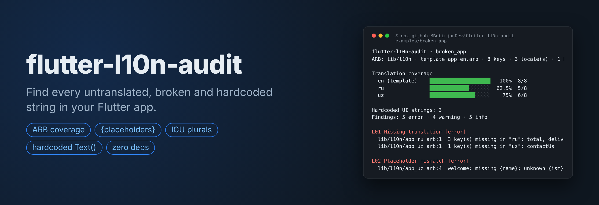
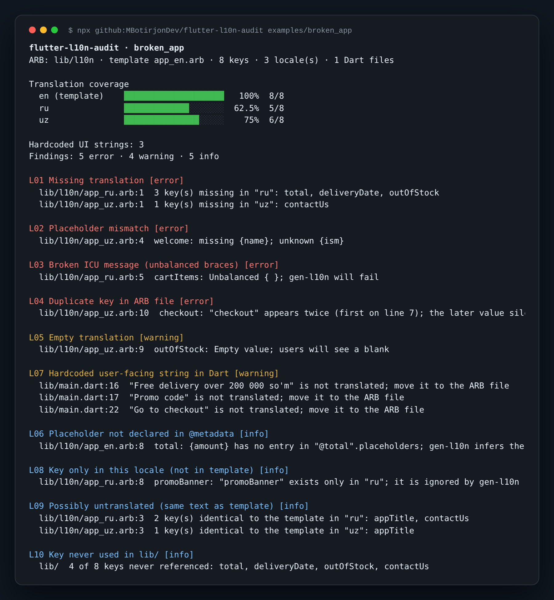

<p align="center"></p>

<p align="center"><b>Find every untranslated, broken and hardcoded string in your Flutter app. One command, zero dependencies.</b></p>

<p align="center">
<a href="https://github.com/MBotirjonDev/flutter-l10n-audit/actions"></a>


</p>

<p align="center"></p>

## Run it

```sh
npx github:MBotirjonDev/flutter-l10n-audit path/to/your_flutter_app
```

Or as an agent skill (Claude Code, Codex, Cursor and others that read `SKILL.md`): copy
`skills/flutter-l10n-audit` into your skills folder and ask *"audit my app's translations"*.
The agent runs the script, explains the findings and fixes them in a safe order.

Options: `--json`, `--fail-on error|warning|info` (CI), `--no-hardcoded`, `--no-unused`.

## What it finds

| Rule | Severity | What | Why it hurts |
|---|---|---|---|
| L01 | error | Keys missing in a locale | users see English in the middle of their language |
| L02 | error | `{name}` renamed or dropped by a translator | the price, name or count disappears |
| L03 | error | Unbalanced `{ }` in a plural/select, invalid JSON | `flutter gen-l10n` fails |
| L04 | error | Same key twice in one ARB | one translation is silently lost |
| L05 | warning | Empty value | blank text on screen |
| L06 | info | Placeholder without `@key` metadata | no typed or formatted parameter |
| L07 | warning | `Text('Buy now')`, `hintText: '...'`, `tooltip: '...'` | never translated |
| L08 | info | Key only in one locale | leftover; ignored by gen-l10n |
| L09 | info | Same text as the template | probably not translated yet |
| L10 | info | Key never used in `lib/` | dead translation work |

Plus a **coverage bar per locale**, lowest first. Details and fixes: [`references/rules.md`](skills/flutter-l10n-audit/references/rules.md).

## Real results

Run on 2026-11-20 on the default branch of three well-known open-source Flutter apps. Every
L02 and L03 finding below was opened and checked by hand.

| App | Keys | Locales | Fully translated | Placeholder bugs (L02) | Broken ICU (L03) | Hardcoded strings (L07) |
|---|---|---|---|---|---|---|
| [wger](https://github.com/wger-project/flutter) `b7b7f25` | 582 | 40 | 2 | 2 | 0 | 37 |
| [lichess mobile](https://github.com/lichess-org/mobile) `7b32d80` | 2244 | 53 | 15 | 2 | 0 | 196 |
| [Open Food Facts](https://github.com/openfoodfacts/smooth-app) `0bf010a` | 1979 | 127 | 0 | 7 | 1 | 19 |

Examples of what it caught:

- **Open Food Facts, French:** `outdated_image_accessibility_label` is literally `"ma traduction"` ("my translation"), and `{imageType}` is gone.
- **Open Food Facts, Lithuanian:** `prices_button_count_price` has an extra `}` at the end of the plural.
- **wger, Arabic:** `topSet` (`"Top set: {value}"`) contains a different sentence and no `{value}`; **Russian** `supersetNr` drops `{nr}`.
- **lichess, Ukrainian:** `mobileIfAccountMatchesCodeSent` drops both `{param1}` and `{param2}`.

Validating on these repos also found three false positives in the first version of this tool
(apostrophe escaping, intentionally empty strings, a too-strong L06 claim). They were fixed
and covered by tests before release.

## How it works

`skills/flutter-l10n-audit/scripts/l10n-audit.cjs` is one Node file with no dependencies. It
reads `l10n.yaml` (`arb-dir`, `template-arb-file`, `use-escaping`), parses every ARB with a
small ICU parser (nested plural/select branches included), scans raw JSON for duplicate keys,
and reads `lib/**/*.dart` line by line for user-facing literals. It reads files only: no
writes, no network.

## Honest limits

- ARB (gen-l10n / intl) only. `easy_localization` JSON and `slang` YAML projects get the
  hardcoded-string check only.
- L07 is line-based: strings split across lines are missed, and debug or dev-mode screens are
  reported too. Add `// l10n-ignore` to a line to accept it.
- L10 is a text search for `.key`; dynamic lookups are not seen.
- It does not judge translation quality: a wrong but well-formed sentence with the right
  placeholders passes. That still needs a native speaker.

## Develop

```sh
npm test                   # node:test, every rule has a positive and a negative case
node skills/flutter-l10n-audit/scripts/l10n-audit.cjs examples/broken_app
npm run package:skill      # dist/flutter-l10n-audit-<version>.zip for skill marketplaces
```

MIT © 2026 Botirjon ([@MBotirjonDev](https://github.com/MBotirjonDev))
